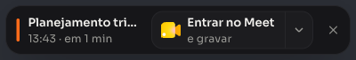
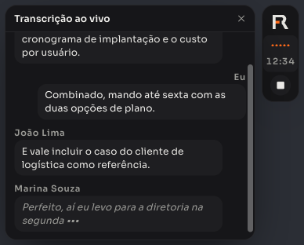
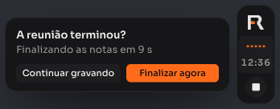
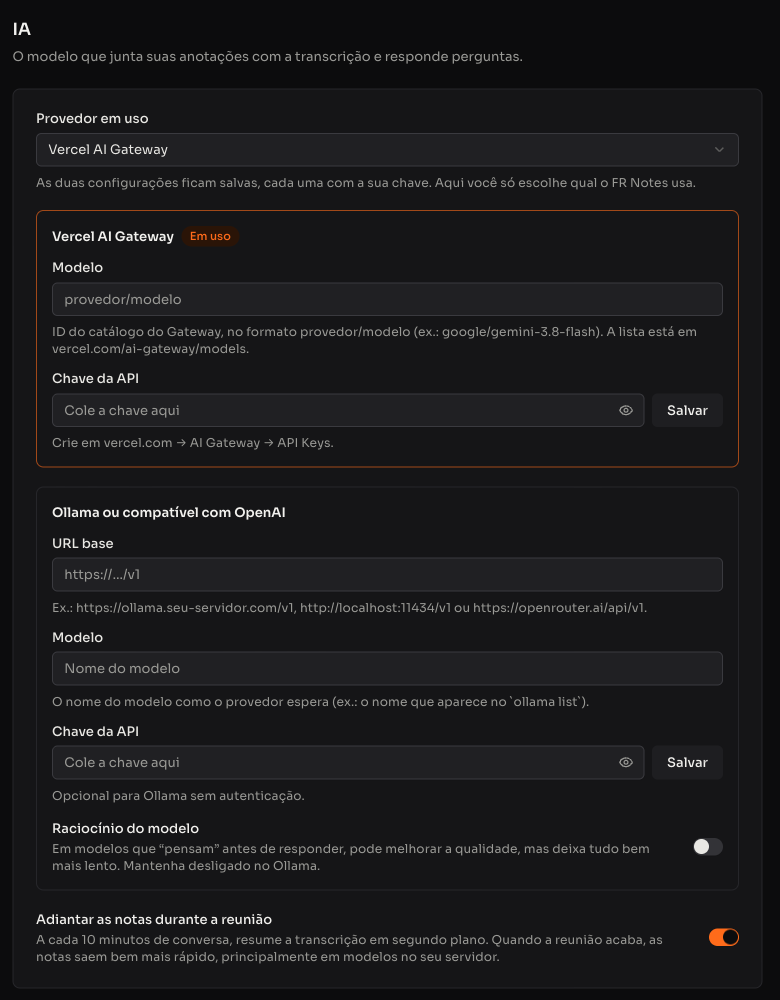

<div align="center">


# FR Notes

**Notas de reunião com IA para macOS — você anota o essencial, o FR Notes ouve a reunião e escreve o resto.**

[](https://github.com/feliperogerioalmeida/fr-notes/releases/latest)
[](LICENSE)


[Recursos](#recursos) · [Instalação](#instalação) · [Configuração](#configuração-passo-a-passo) · [Como usar](#como-usar) · [Privacidade](#privacidade-e-dados) · [Problemas](#solução-de-problemas) · [Desenvolvimento](#desenvolvimento)

</div>

<br />

<p align="center">
  
</p>

## Sobre

O FR Notes é um app desktop open source para quem passa o dia em reuniões. Durante a chamada você escreve só o que importa; o app transcreve em tempo real **você** (microfone) e **os outros participantes** (áudio do computador). Quando a reunião acaba, a IA junta suas anotações com a transcrição e entrega notas organizadas por assunto, com decisões, pendências e próximos passos.

- **Local-first:** notas, transcrições, áudio e configurações ficam no seu Mac.
- **Sem bot na reunião:** nada entra na chamada; o áudio é capturado direto do sistema.
- **Você escolhe os provedores:** transcrição com Deepgram e IA com o modelo que preferir — na nuvem pelo Vercel AI Gateway ou no seu próprio servidor com Ollama.
- **Sem servidor do FR Notes:** o app fala direto com os provedores que você configurar. Não há conta, login nem coleta de uso.
- **Leve:** feito com Tauri e Rust, ocupa cerca de 25 MB.

## Recursos

### Durante a reunião

|                                  |                                                                                                                                                                                                   |
| -------------------------------- | ------------------------------------------------------------------------------------------------------------------------------------------------------------------------------------------------- |
| 🎙️ **Transcrição em tempo real** | Seu microfone (“Eu”) e o áudio do computador em canais separados, com Deepgram nova-3, cancelamento de eco para usar sem fone e vocabulário personalizado.                                        |
| 🔔 **Detecção de reunião**       | Percebe quando Zoom, Meet, Teams, Slack, FaceTime, Discord, Webex ou WhatsApp começam a usar o microfone e oferece gravar — ou grava sozinho. Também avisa 1 minuto antes das reuniões da agenda. |
| 🟠 **Indicador flutuante**       | Uma pílula pequena no canto da tela mostra que está gravando, com o tempo e o botão de parar. Ela desce sozinha quando já há outra notificação no canto, como a de outro app de notas.            |
| 💬 **Transcrição ao vivo**       | Clique nas barrinhas de áudio da pílula para abrir as falas da reunião ao lado dela, como balões de chat.                                                                                         |
| 🏁 **Fim automático**            | Quando o app da reunião solta o microfone, o FR Notes pergunta “A reunião terminou?” e, depois de uma contagem de 10 segundos, finaliza e gera as notas. Você pode continuar gravando.            |
| 🗣️ **Quem disse o quê**          | As vozes dos outros participantes são separadas automaticamente e ganham nome quando o app lê, na janela do Meet ou do Teams, quem está falando (beta). Você também pode nomear com um clique.    |
| ⌨️ **Ditado em qualquer app**    | Segure `fn`, fale e solte: o texto é digitado onde está o cursor — e-mail, Slack, WhatsApp, editor de código. Opcionalmente polido pela IA.                                                       |

<p align="center">
  
  <br />
  
  
</p>

### Depois da reunião

|                              |                                                                                                                                                                                         |
| ---------------------------- | --------------------------------------------------------------------------------------------------------------------------------------------------------------------------------------- |
| ✨ **Notas geradas pela IA** | Resumo no topo, uma seção por assunto com quem disse o quê, decisões e pendências, e próximos passos agrupados por responsável. Suas anotações viram a espinha das notas finais.        |
| 🧩 **Templates**             | Reunião geral, Aula / Workshop, Cliente/Descoberta, 1:1, Daily, Kickoff e Entrevista — ou crie os seus. Dá para regerar a mesma reunião com outro template.                             |
| ✅ **Próximos passos**       | As tarefas combinadas viram uma lista com responsável e prazo, por reunião e numa página só. Marque como feito ou envie cada uma para ClickUp, Linear, Notion ou Slack.                 |
| 💬 **Pergunte à reunião**    | Chat sobre cada nota: “quais foram os próximos passos?”, “escreva o follow-up”.                                                                                                         |
| 🧠 **Pergunte às reuniões**  | “Quando falamos do orçamento da Marina?” A resposta cita a reunião e o trecho, com links para o momento exato da conversa.                                                              |
| 🔎 **Busca em tudo**         | ⌘K procura em títulos, anotações, notas da IA e transcrições, sem se importar com acentos.                                                                                              |
| 🛟 **À prova de falhas**     | Se a internet cair, a transcrição volta sozinha sem perder o horário das falas. O áudio fica guardado no Mac para refazer a transcrição, e uma gravação interrompida pode ser retomada. |
| 📋 **Copiar e compartilhar** | Copie a nota em Markdown ou a transcrição inteira, com horário e nome de quem falou. Envie notas para outros sistemas por webhook assinado.                                             |
| 📥 **Importar transcrições** | Traga reuniões gravadas em outro app, como o Granola: cole a transcrição ou escolha arquivos `.txt`/`.md`, e a IA gera as notas com o mesmo template das suas reuniões.                 |

### Organização

|                               |                                                                                                                                          |
| ----------------------------- | ---------------------------------------------------------------------------------------------------------------------------------------- |
| 📅 **Agenda**                 | Dia, semana, mês e lista com todas as contas do app Calendário da Apple (iCloud, Google, Exchange…). Entre e grave a reunião num clique. |
| 📁 **Pastas**                 | Organize as notas em pastas e subpastas.                                                                                                 |
| 📊 **Resumo da semana**       | Quantas notas, quanto tempo gravado e quantos próximos passos estão em aberto.                                                           |
| 🔄 **Atualização automática** | O app se atualiza sozinho, nunca durante uma gravação.                                                                                   |

<p align="center">
  
  
</p>

## Requisitos

- Mac com **Apple Silicon** (M1 ou mais novo).
- **macOS 14.4 ou mais novo** recomendado. No macOS 13 a 14.3 o áudio do computador usa o modo de Gravação de Tela, que exige reiniciar o app depois de permitir.
- Uma conta na **[Deepgram](https://console.deepgram.com)** para a transcrição (a Deepgram dá crédito para começar).
- Um provedor de IA para as notas e o chat — veja [as opções](#3-ia-das-notas-e-do-chat).

## Instalação

1. Baixe o arquivo `FR-Notes_<versão>_aarch64.dmg` na **[última versão](https://github.com/feliperogerioalmeida/fr-notes/releases/latest)**.
2. Abra o `.dmg` e arraste o **FR Notes** para a pasta **Aplicativos**.
3. Abra o FR Notes. Como o app não é distribuído pela App Store nem assinado por uma conta Apple Developer, o macOS bloqueia a primeira abertura:
   - vá em **Ajustes do Sistema → Privacidade e Segurança**, role até o aviso sobre o FR Notes e clique em **Abrir Mesmo Assim**;
   - ou, pelo Terminal: `xattr -dr com.apple.quarantine "/Applications/FR Notes.app"`.

Isso só é necessário na instalação. As atualizações seguintes são instaladas pelo próprio app.

## Configuração passo a passo

Tudo fica em **Configurações** (canto inferior esquerdo). Um ponto ao lado de uma seção indica que falta algo nela.

### 1. Permissões do macOS

Em **Configurações → Permissões**, clique em **Permitir** em cada item. O macOS mostra um aviso; se ele mandar abrir os Ajustes do Sistema, ligue o **FR Notes** na lista.

| Permissão        | Para quê                                                                                                        | Obrigatória? |
| ---------------- | --------------------------------------------------------------------------------------------------------------- | ------------ |
| Microfone        | Transcrever o que você fala (“Eu”).                                                                             | Sim          |
| Áudio do sistema | Transcrever os outros participantes.                                                                            | Sim          |
| Calendário       | Mostrar a agenda, avisar antes das reuniões e preencher título e participantes das notas.                       | Recomendada  |
| Acessibilidade   | Ler na janela da reunião quem está falando (para dar nome às vozes) e digitar o ditado no app em que você está. | Recomendada  |

> O FR Notes só aparece na lista de **Acessibilidade** dos Ajustes do Sistema depois que você clica em **Permitir** dentro do app. Se a permissão faltar durante uma reunião, o app avisa com um botão para pedir de novo.

### 2. Transcrição (Deepgram)

1. Crie uma conta em [console.deepgram.com](https://console.deepgram.com) e gere uma chave em **API Keys**.
2. Em **Configurações → Transcrição**, cole a chave em **Chave da Deepgram** e clique em **Salvar**. Ela vai para o **Keychain do macOS**, nunca para arquivo.
3. Escolha o **Idioma da reunião**: Português (Brasil), Inglês ou Multilíngue (para reuniões que alternam idiomas).
4. Em **Vocabulário**, adicione nomes de pessoas, empresas, produtos e siglas que aparecem nas suas reuniões. Isso ajuda a Deepgram a escrevê-los certo.
5. Deixe ligados **Capturar áudio do computador** (sem ele, só a sua voz é transcrita) e **Cancelamento de eco** (evita que a voz dos outros, saindo do alto-falante, apareça como sua).
6. Em **Áudio das reuniões**, escolha se o app guarda o áudio (ligado por padrão) e por quanto tempo: 7, 30 ou 90 dias, ou para sempre. Com o áudio guardado você pode **refazer a transcrição** de uma reunião.

### 3. IA das notas e do chat

O FR Notes guarda **duas configurações de IA lado a lado**, cada uma com seu modelo e sua chave. Em **Configurações → IA**, o campo **Provedor em uso** só escolhe qual delas o app usa — trocar não apaga a outra.

<p align="center">
  
</p>

**Opção A — Vercel AI Gateway (recomendada).** Uma chave dá acesso a centenas de modelos, pagos por uso.

1. Crie uma conta na [Vercel](https://vercel.com), abra **AI Gateway → API Keys** e clique em **Create Key**.
2. No painel **Vercel AI Gateway**, cole a chave em **Chave da API** e clique em **Salvar**.
3. Em **Modelo**, escolha na lista, que vem do [catálogo do Gateway](https://vercel.com/ai-gateway/models) com o preço por milhão de tokens, o tamanho do contexto e as marcas **rápido** e **raciocínio**. Dá para buscar por nome, provedor ou ID.
4. Em **Provedor em uso**, escolha **Vercel AI Gateway**.

Comparamos quatro modelos com a mesma reunião de 1h25 e o mesmo prompt:

| Modelo                       | Tempo | Custo da reunião | Observação                                     |
| ---------------------------- | ----- | ---------------- | ---------------------------------------------- |
| `alibaba/qwen3.7-plus`       | 75 s  | ~US$ 0,02        | O escolhido: notas certeiras, rápido e barato. |
| `google/gemini-3.8-flash`    | 36 s  | ~US$ 0,03        | O mais rápido.                                 |
| `deepseek/deepseek-v4-flash` | 3 min | ~US$ 0,01        | Barato, mas “pensa” muito antes de escrever.   |
| `alibaba/qwen3.8-flash`      | 4 min | ~US$ 0,01        | Notas longas e detalhadas, bem mais lento.     |

**Opção B — Ollama ou qualquer API compatível com OpenAI.** Para rodar um modelo no seu Mac ou no seu servidor, ou usar outro provedor (OpenRouter, Groq…).

1. No painel **Ollama ou compatível com OpenAI**, preencha a **URL base**:
   - Ollama no seu Mac: `http://localhost:11434/v1` (sem chave);
   - Ollama no seu servidor: `https://ollama.seu-dominio.com/v1` — o guia [infra/ollama](infra/ollama/README.md) sobe o Ollama num VPS com Coolify, protegido por chave;
   - OpenRouter: `https://openrouter.ai/api/v1`.
2. Em **Modelo**, escolha na lista de modelos que o servidor informa; se ele não listar, digite o nome (no Ollama, o que aparece em `ollama list`).
3. Se o provedor exigir, cole a chave em **Chave da API**.
4. Deixe **Raciocínio do modelo** desligado em modelos locais: “pensar” antes de responder deixa tudo muito mais lento em CPU.
5. Em **Provedor em uso**, escolha **Ollama ou compatível com OpenAI**.

> Modelos pequenos rodando em CPU têm pouca memória de contexto. Uma reunião de 1h30 tem cerca de 20 mil tokens; se o modelo aceitar menos que isso, o começo da reunião fica de fora. Para esses casos, ligue **Adiantar as notas durante a reunião**: a cada 10 minutos o app resume a conversa em segundo plano, e as notas finais usam esses resumos. Com um modelo na nuvem, deixe desligado — o modelo lê a reunião inteira e as notas saem mais detalhadas.

**IA por função.** As notas usam o **Provedor em uso**. Em **IA por função** você pode dar um modelo próprio ao **Perguntar e chat da nota** e ao **Ditado**, com as mesmas chaves. O ditado precisa responder em 1 a 2 segundos: prefira um modelo marcado como rápido e sem raciocínio (medimos ~1 s com `google/gemini-3.1-flash-lite`; modelos com raciocínio levaram de 10 a 30 s).

### 4. Sobre você

Em **Configurações → Geral**:

- **Sobre você:** seu **Nome** e um **Contexto** curto (cargo, empresa, projetos). A IA usa isso para saber quem é o “Eu” da transcrição e escrever notas do seu ponto de vista.
- **Preferências:** o **Template padrão** das notas e o **Tema** (escuro, claro ou seguir o sistema).
- **Inicialização:** **Abrir o FR Notes ao entrar no Mac**, escondido na barra de menus, pronto para detectar reuniões e para o ditado.

### 5. Reuniões e agenda

Em **Configurações → Reuniões e agenda**:

- **Quando detectar uma reunião:** perguntar se quero gravar, começar a gravar sozinho ou desligada.
- **Parar quando a reunião acabar:** liga o fim automático com a contagem de 10 segundos.
- **Avisar antes das reuniões da agenda:** mostra o aviso 1 minuto antes, com o botão de entrar e gravar.
- **Quem está falando:** **Identificar quem fala pela janela da reunião** (precisa da permissão de Acessibilidade) e **Salvar diagnóstico local (beta)**, que guarda no Mac o que o app leu da janela da reunião para melhorar o reconhecimento de cada app.
- **Calendários:** escolha quais calendários aparecem na agenda.

### 6. Ditado e atalhos

Em **Configurações → Ditado e atalhos**:

- **Ditar em qualquer app** e a **Tecla do ditado** (`fn` por padrão).
- **Polir com IA:** corrige pontuação e vícios de fala antes de digitar. O modelo do ditado fica em **Configurações → IA → IA por função**.
- **Atalhos globais:** começar ou parar a gravação de uma reunião (⌥ ⇧ R por padrão), mesmo com o app em segundo plano.

### 7. Conexões e integrações (opcional)

Em **Conexões** você liga só os apps que usa. Nada é enviado automaticamente: na hora de mandar um próximo passo ou uma nota, você escolhe o destino.

| App     | Recebe                    | O que você precisa                                                        |
| ------- | ------------------------- | ------------------------------------------------------------------------- |
| ClickUp | Próximos passos (tarefas) | Token pessoal da API (_Settings → Apps_) e a lista de destino             |
| Linear  | Próximos passos (issues)  | Personal API key (_Settings → Security & access_) e o time                |
| Notion  | Notas (páginas)           | Token de uma integração interna e um banco de dados compartilhado com ela |
| Slack   | Notas e próximos passos   | URL de um Incoming Webhook do canal                                       |

Você pode ter vários destinos do mesmo app (por exemplo, duas listas do ClickUp). Cada próximo passo enviado guarda o link para abrir no app de destino.

Em **Configurações → Integrações** você cadastra **webhooks**: a cada gravação finalizada (`note.completed`) e a cada nota gerada pela IA (`note.enhanced`), o FR Notes faz um `POST` com a nota completa em JSON, assinado com HMAC-SHA256, com novas tentativas automáticas e botão **Testar**. Formato e exemplos de verificação em **[docs/webhooks.md](docs/webhooks.md)**.

## Como usar

### Antes

- A **Agenda** mostra suas reuniões. **Preparar notas** cria a nota com título e participantes; **Gravar agora** já começa a gravar.
- 1 minuto antes de uma reunião, ou quando um app de reunião abre o microfone, aparece o aviso no canto da tela com **Entrar no Meet e gravar** e, na setinha ao lado, **Só gravar, sem abrir a reunião**, **Só abrir o Meet** ou **Agora não**.
- Também dá para começar pelo botão **Gravar reunião**, pelo atalho ⌥ ⇧ R ou por **Nova nota** no ícone da barra de menus.

### Durante

- A pílula no canto da tela mostra o tempo de gravação. Clique no símbolo **FR** para abrir a nota, nas **barrinhas de áudio** para ver a transcrição ao vivo e no **quadrado** para parar. Você pode arrastá-la para outro lugar.
- Escreva na nota só o essencial: um nome, um número, uma decisão. A IA usa suas anotações como espinha das notas finais.
- A transcrição completa fica no painel lateral da nota.

### Depois

1. Quando a chamada termina, o FR Notes pergunta “A reunião terminou?” e finaliza sozinho. Você também pode parar pela pílula ou pela barra inferior da nota.
2. As notas são geradas com o template padrão. Alterne entre **Notas FR** e **Minhas notas**, ou **Regerar** com outro template.
3. No painel **Transcrição**:
   - clique no nome de uma voz (“Pessoa 1”) para dar o nome certo — vale para a reunião inteira;
   - **copie** a transcrição inteira;
   - **refaça a transcrição** a partir do áudio guardado (útil se a internet caiu ou se você mudou o vocabulário). Depois, regere as notas.
4. No painel **Próximos passos**, marque o que foi feito ou envie cada tarefa — ou todas — para uma conexão. A página **Próximos passos** junta tudo: filtre por **Meus** (os seus, os da turma toda e os sem responsável) ou por pessoa, e agrupe por reunião ou por pessoa.
5. Pergunte qualquer coisa à reunião no chat, ou à sua base inteira em **Perguntar**.
6. Clique na data da nota para corrigir o dia e o horário; a transcrição acompanha.

### Importar de outro app (Granola e outros)

1. No **Início**, clique em **Importar**.
2. Cole a transcrição ou clique em **Escolher arquivos** para trazer várias de uma vez (`.txt` ou `.md`). No Granola, abra a reunião e copie a transcrição; o formato esperado é uma fala por linha, `Nome: fala`, com um cabeçalho opcional (`Meeting Title:`, `Date:`).
3. Confira a prévia (título, data, quantidade de falas e quem participou) e ajuste o **Horário de início**, já que a cópia do Granola só traz a data. “Me” e o seu nome viram “Eu”; “Them” e “Speaker A” viram vozes sem nome, que você pode nomear depois.
4. Clique em **Importar**. Com **Gerar as notas com a IA** ligado, as notas são escritas uma reunião por vez com o provedor em uso.

Como o texto importado não tem horário de cada fala, o FR Notes distribui as falas a partir do horário de início pelo tamanho de cada uma — a ordem fica certa e a duração, aproximada.

### Ditado

- **Segure `fn` (🌐)** em qualquer app, fale e solte. Um toque rápido deixa o microfone aberto; `Esc` cancela.
- Tudo o que você dita fica salvo em **Ditados**.

## Atualizações

O FR Notes procura novas versões ao abrir e a cada 6 horas. Quando encontra, baixa e instala em segundo plano — nunca durante uma gravação — e avisa para reiniciar. Você também pode procurar manualmente em **Configurações → Sobre**.

Cada atualização é assinada; o app só instala pacotes cuja assinatura confere com a chave pública embutida nele.

> Depois de uma atualização, o macOS pode pedir a senha do Mac **uma vez** para o FR Notes acessar as chaves no Keychain. Clique em **Permitir Sempre**. Isso acontece porque o app não é assinado por uma conta Apple Developer, então o macOS trata cada versão como um app novo; todas as chaves ficam num único item do Keychain para que seja um pedido só.

## Privacidade e dados

| O quê                                  | Onde fica / para onde vai                                                                                                                                |
| -------------------------------------- | -------------------------------------------------------------------------------------------------------------------------------------------------------- |
| Notas, transcrições, pastas, templates | Banco SQLite local em `~/Library/Application Support/dev.feliperogerio.notes/`                                                                           |
| Chaves de API e tokens                 | Keychain do macOS, num único item do serviço `dev.feliperogerio.notes`                                                                                   |
| Áudio da reunião                       | Enviado em tempo real à Deepgram para transcrição e guardado no Mac (`recordings/`) pelo tempo que você escolher — 30 dias por padrão. Dá para desligar. |
| Diagnóstico de quem fala               | Com **Salvar diagnóstico local** ligado, o que o app leu da janela da reunião fica no Mac (`speaker-diagnostics/`) por 14 dias. Nunca é enviado.         |
| Texto para gerar notas e responder     | Enviado ao provedor de IA em uso, só quando você gera notas, regera ou pergunta algo                                                                     |
| Notas enviadas por webhook             | Só para as URLs que você cadastrar em Integrações                                                                                                        |
| Próximos passos e notas enviados       | Só para a conexão que você escolher, no momento em que clicar em enviar                                                                                  |

O FR Notes não tem servidor próprio nem coleta de uso.

## Solução de problemas

| Problema                                                     | O que fazer                                                                                                                                                                    |
| ------------------------------------------------------------ | ------------------------------------------------------------------------------------------------------------------------------------------------------------------------------ |
| Os outros participantes não aparecem na transcrição          | Confira a permissão de **Áudio do sistema** e se **Capturar áudio do computador** está ligado. Se o áudio foi guardado, use **Refazer transcrição**.                           |
| Minha voz aparece como outra pessoa (ou vice-versa)          | Mantenha o **Cancelamento de eco** ligado ou use fone.                                                                                                                         |
| As vozes aparecem como “Pessoa 1”, “Pessoa 2”                | Confira a permissão de **Acessibilidade** e se **Identificar quem fala** está ligado. A identificação ainda é beta; clique no nome da voz no painel Transcrição para corrigir. |
| Mais vozes do que pessoas na reunião                         | A separação automática às vezes divide uma pessoa em duas. Dê o mesmo nome às duas vozes no painel Transcrição.                                                                |
| O macOS pede a senha para acessar o Keychain                 | Clique em **Permitir Sempre**. Deve acontecer no máximo uma vez a cada versão nova (veja [Atualizações](#atualizações)).                                                       |
| Não acho o FR Notes em Acessibilidade nos Ajustes do Sistema | Ele só aparece depois de você clicar em **Permitir** em **Configurações → Permissões** dentro do app.                                                                          |
| “Configure o provedor, o modelo e a chave de IA”             | Complete o painel do **Provedor em uso** em **Configurações → IA**: modelo e chave (no Gateway) ou URL base e modelo (no Ollama).                                              |
| As notas de reuniões longas ignoram o começo                 | O modelo tem pouco contexto. Use um modelo na nuvem ou ligue **Adiantar as notas durante a reunião**.                                                                          |
| O macOS pediu as permissões de novo depois de atualizar      | Acontece quando a assinatura do app muda entre versões; basta permitir novamente.                                                                                              |

## Desenvolvimento

O FR Notes é um monorepo pnpm + Turborepo:

```
apps/
  desktop/        App macOS — Tauri 2 (Rust) + React + Vite
    src/          Interface (React 19, Tailwind 4, shadcn/ui, Tiptap)
    src-tauri/    Núcleo nativo: CoreAudio (process tap), ScreenCaptureKit, Deepgram,
                  EventKit, Acessibilidade, Keychain, janela flutuante
  backend/        API Fastify (base para a futura sincronização)
  frontend/       Web Next.js
  mobile/         App Expo (futuro FR Notes para reuniões presenciais)
packages/
  core/           Domínio compartilhado: schemas, SQLite, prompts, transcrição
  ui/             Design system FR (tokens + shadcn/ui)
infra/
  ollama/         Ollama + gateway com chave, para subir num VPS com Coolify
```

Pré-requisitos: macOS com Apple Silicon, Node 24, pnpm 10, Rust estável e Xcode Command Line Tools.

```bash
pnpm install
pnpm --filter desktop setup:signing  # cria o certificado local "FR Notes Development" (uma vez)
pnpm --filter desktop start          # modo desenvolvimento (tauri dev)
pnpm --filter desktop start:app      # gera e abre o FR Notes.app — use para testar permissões
```

Sem o certificado local, cada build sai com assinatura ad-hoc e o macOS pede as permissões de novo a cada vez.

**Modo preview.** Com o `start` rodando, abrir `http://localhost:1420` no navegador carrega a interface com IPC simulado, SQLite em memória e dados de exemplo — útil para trabalhar na interface sem o app nativo. No console do navegador há controles para simular situações, como `simulateNubPrompt()`, `simulateNubRecording()`, `simulateNubTranscript()`, `simulateNubEnding()`, `simulateMeetingApp()` e `simulateDictation()`. A janela flutuante fica em `http://localhost:1420/#/nub`.

**Testes e qualidade.**

```bash
pnpm --filter @workspace/core test         # domínio (Vitest)
cd apps/desktop/src-tauri && cargo test    # núcleo nativo
pnpm --filter desktop lint                 # ESLint
cd apps/desktop && npx tsc --noEmit        # tipos
```

**Publicar uma versão.**

```bash
pnpm --filter desktop release 0.5.0 "O que mudou nesta versão"
```

O script atualiza a versão, gera o `.dmg` e o pacote de atualização assinado com a chave do updater (`~/.tauri/fr-notes-updater.key`, que nunca vai para o repositório) e publica em [Releases](https://github.com/feliperogerioalmeida/fr-notes/releases). Com `PUBLISH=false` ele só gera os arquivos localmente.

As convenções de código e as decisões de arquitetura estão em [`CLAUDE.md`](CLAUDE.md).

## Roadmap

- [x] Transcrição em tempo real com cancelamento de eco
- [x] Notas com IA, templates e chat
- [x] Calendário da Apple, agenda e detecção de reunião
- [x] Instalador `.dmg` com atualização automática
- [x] Webhooks e conexões (ClickUp, Linear, Notion, Slack)
- [x] Ditado em qualquer app
- [x] Perguntar a todas as reuniões, com citações
- [x] Áudio guardado, refazer transcrição e retomar gravação interrompida
- [x] Transcrição ao vivo na pílula e fim automático da reunião
- [ ] Nome de quem fala detectado com precisão no Meet e no Teams (hoje em beta)
- [ ] Assinatura com conta Apple Developer (sem aviso na primeira abertura e sem pedidos do Keychain após atualizar)
- [ ] API para outros sistemas consultarem as notas com API key
- [ ] App para iPhone, para reuniões presenciais
- [ ] Sincronização com o ambiente FR

## Licença e marca

O código é distribuído sob a [licença MIT](LICENSE).

O nome **FR Notes**, o símbolo **FR** e a identidade visual da marca Felipe Rogério **não** fazem parte da licença MIT. Se você fizer um fork e distribuir, use outro nome e outro ícone.

Os logos de ClickUp, Linear, Notion e Slack vêm do conjunto [Logos do Iconify](https://icon-sets.iconify.design/logos/) (CC0) e são marcas dos seus donos, usadas só para identificar as integrações.

<br />

<p align="center">Feito por <a href="https://github.com/feliperogerioalmeida">Felipe Rogério</a>.</p>
