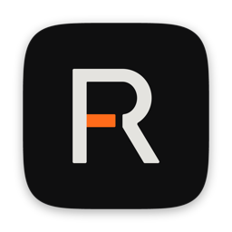
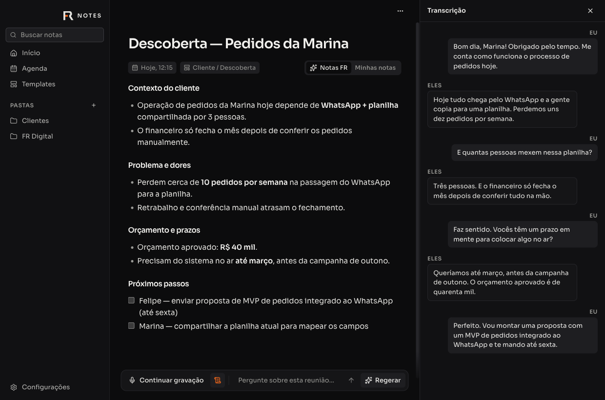
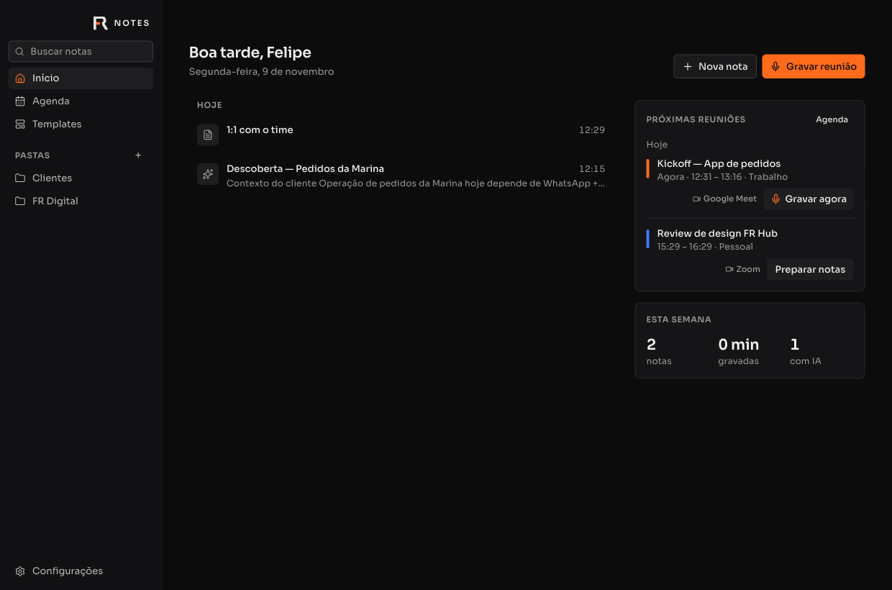
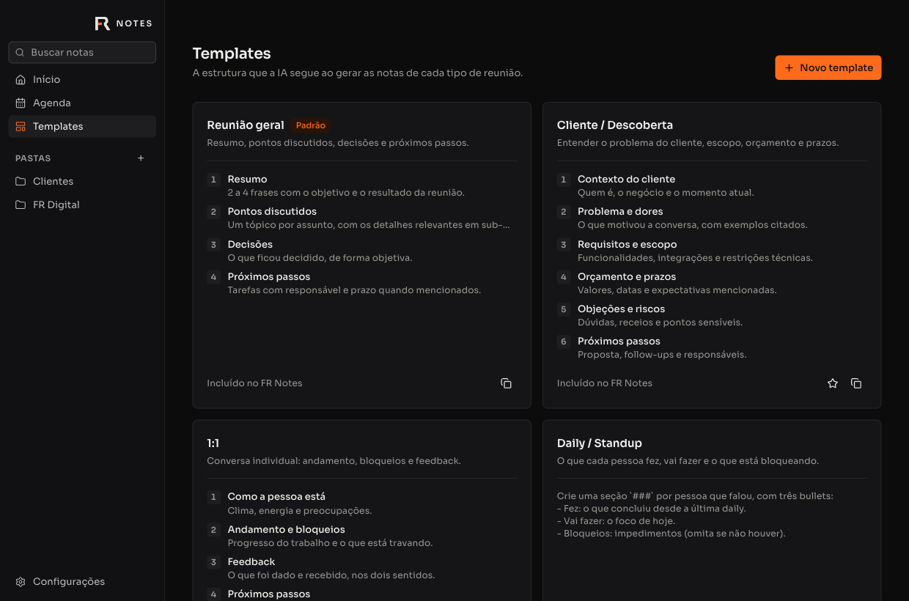
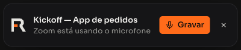

<div align="center">



# FR Notes

**Notas de reunião com IA para macOS — você anota o essencial, o FR Notes ouve a reunião e escreve o resto.**

[](https://github.com/feliperogerioalmeida/fr-notes/releases/latest)
[](LICENSE)


[Baixar](#instalação) · [Configurar](#configuração-inicial) · [Como usar](#como-usar) · [Integrações](#integrações) · [Privacidade](#privacidade-e-dados) · [Desenvolvimento](#desenvolvimento)

</div>

<br />

<p align="center">
  
</p>

## Sobre

O FR Notes é um app desktop para quem passa o dia em reuniões. Durante a chamada você escreve só o que importa; o app transcreve, em tempo real, **você** (microfone) e **os outros participantes** (áudio do computador). No fim, a IA junta suas anotações com a transcrição e entrega notas organizadas, com decisões e próximos passos.

- **Local-first:** notas, transcrições e configurações ficam no seu Mac.
- **Sem bot na reunião:** nada entra na chamada; o áudio é capturado direto do sistema.
- **Você escolhe os provedores:** transcrição com Deepgram e IA com o modelo que preferir.
- **Leve:** feito com Tauri e Rust, ocupa cerca de 25 MB.

## Recursos

|                                  |                                                                                                                                                                                                         |
| -------------------------------- | ------------------------------------------------------------------------------------------------------------------------------------------------------------------------------------------------------- |
| 🎙️ **Transcrição em tempo real** | Seu microfone (“Eu”) e o áudio do computador em canais separados, com Deepgram nova-3, cancelamento de eco para usar sem fone e vocabulário personalizado.                                              |
| 🗣️ **Quem disse o quê**          | As vozes dos outros participantes são separadas automaticamente e ganham nome sozinhas quando o app vê, na janela do Meet ou do Teams, quem está falando (beta). Você também pode nomear com um clique. |
| ⌨️ **Ditado em qualquer app**    | Segure `fn`, fale e solte: o texto é digitado onde está o cursor — e-mail, Slack, WhatsApp, editor de código. Opcionalmente polido pela IA.                                                             |
| ✨ **Notas geradas pela IA**     | Suas anotações viram a espinha das notas finais, completadas com o que foi dito. O título é sugerido automaticamente.                                                                                   |
| 🧩 **Templates**                 | Reunião geral, Cliente/Descoberta, 1:1, Daily, Kickoff e Entrevista — ou crie os seus.                                                                                                                  |
| 💬 **Pergunte à reunião**        | Chat sobre cada nota: “quais foram os próximos passos?”, “escreva o follow-up”.                                                                                                                         |
| ✅ **Próximos passos**           | As tarefas combinadas viram uma lista com responsável e prazo, por reunião e numa página só. Marque como feito ou envie cada uma para onde quiser.                                                      |
| 📅 **Calendário da Apple**       | Próximas reuniões e agenda com todas as contas do app Calendário (iCloud, Google, Exchange…). Notas já nascem com título e participantes.                                                               |
| 🔔 **Detecção de reunião**       | Percebe quando Zoom, Meet, Teams, Slack ou FaceTime começam a usar o microfone e oferece gravar — ou grava sozinho.                                                                                     |
| 🟠 **Indicador flutuante**       | Um mini símbolo FR no canto da tela mostra que está ouvindo, com tempo e botão de parar.                                                                                                                |
| 🔄 **Atualização automática**    | O app se atualiza sozinho, sem precisar baixar o instalador de novo.                                                                                                                                    |
| 🔌 **Conexões**                  | ClickUp, Linear, Notion e Slack: você conecta o que usa e escolhe o destino na hora de enviar um próximo passo ou uma nota.                                                                             |
| 🔗 **Webhooks**                  | Envia cada nota para outros sistemas (FR Hub, n8n, Make, seu backend) por webhook assinado, com a API key que o destino exigir.                                                                         |

<p align="center">
  
  
</p>

<p align="center">
  
</p>

## Requisitos

- Mac com **Apple Silicon** (M1 ou mais novo).
- **macOS 14.4 ou mais novo** recomendado. No macOS 13 a 14.3 o áudio do computador usa o modo de Gravação de Tela, que exige reiniciar o app depois de permitir.
- Uma conta na **[Deepgram](https://console.deepgram.com)** para a transcrição.
- Um provedor de IA para as notas e o chat: **[Vercel AI Gateway](https://vercel.com/ai-gateway)** ou qualquer API compatível com OpenAI, como **[OpenRouter](https://openrouter.ai)** ou **[Ollama](https://ollama.com)** rodando no seu Mac ou servidor.

## Instalação

1. Baixe o arquivo `FR-Notes_<versão>_aarch64.dmg` na **[última versão](https://github.com/feliperogerioalmeida/fr-notes/releases/latest)**.
2. Abra o `.dmg` e arraste o **FR Notes** para a pasta **Aplicativos**.
3. Abra o FR Notes. Como o app não é distribuído pela App Store, o macOS bloqueia a primeira abertura:
   - vá em **Ajustes do Sistema → Privacidade e Segurança**, role até o aviso sobre o FR Notes e clique em **Abrir Mesmo Assim**;
   - ou, pelo Terminal: `xattr -dr com.apple.quarantine "/Applications/FR Notes.app"`.

Isso só é necessário na instalação. As atualizações seguintes são instaladas pelo próprio app.

## Configuração inicial

Abra **Configurações** na barra lateral.

### 1. Permissões do macOS

Em **Permissões do macOS**, clique em **Permitir** em cada item:

| Permissão        | Para quê                                                         |
| ---------------- | ---------------------------------------------------------------- |
| Microfone        | Transcrever o que você fala (“Eu”).                              |
| Áudio do sistema | Transcrever os outros participantes (“Eles”).                    |
| Calendário       | Mostrar as próximas reuniões e preencher título e participantes. |
| Acessibilidade   | Digitar o ditado no app em que você está escrevendo.             |

### 2. Transcrição (Deepgram)

1. Crie uma conta em [console.deepgram.com](https://console.deepgram.com) e gere uma chave em **API Keys**.
2. Cole a chave em **Transcrição → Chave da Deepgram**. Ela é guardada no **Keychain do macOS**, nunca em arquivo.
3. Escolha o idioma da reunião (Português, Inglês ou Multilíngue) e, se quiser, adicione nomes e termos em **Vocabulário**.

### 3. IA das notas e do chat

Escolha um provedor e informe o modelo:

- **Vercel AI Gateway:** crie uma chave em _Vercel → AI Gateway → API Keys_ e use o ID do modelo no formato `provedor/modelo` ([catálogo](https://vercel.com/ai-gateway/models)).
- **Compatível com OpenAI:** informe a URL base e o nome do modelo. Exemplos:
  - OpenRouter: `https://openrouter.ai/api/v1`
  - Ollama local: `http://localhost:11434/v1` (sem chave)

### 4. Sobre você e calendários

Preencha seu nome e um pouco de contexto em **Sobre você** — a IA usa isso para saber quem é o “Eu” da transcrição. Em **Calendários**, escolha quais calendários aparecem na agenda.

## Como usar

1. **Comece uma nota** com **Gravar reunião**, pela agenda (**Gravar agora** / **Preparar notas**) ou pelo convite que aparece quando uma reunião é detectada.
2. **Anote o essencial** enquanto a reunião acontece. A transcrição fica no painel lateral (ícone de pergaminho na barra inferior).
3. **Pare a gravação** pelo botão da barra inferior ou pelo indicador flutuante. As notas são geradas automaticamente com o template padrão.
4. **Ajuste e reaproveite:** alterne entre **Notas FR** e **Minhas notas**, regere com outro template, pergunte qualquer coisa à reunião ou copie tudo em Markdown.
5. **Distribua os próximos passos:** abra o painel **Próximos passos** (ícone de checklist na barra inferior) ou a página de mesmo nome e envie cada tarefa — ou todas de uma vez — para a conexão que quiser.

Atalhos úteis:

- **Segure `fn` (🌐) em qualquer app para ditar**; toque rápido deixa o microfone aberto e `Esc` cancela. Tudo o que você dita fica em **Ditados**.
- **⌥ ⇧ R** começa ou para a gravação de uma reunião, mesmo com o app em segundo plano.

- O ícone do FR Notes na barra de menus tem **Nova nota**, que já começa a gravar.
- Em **Configurações → Reuniões** você escolhe se o app deve perguntar, gravar sozinho ou ignorar reuniões detectadas, e se deve parar ao fim da chamada.

## Conexões

Em **Conexões** você liga só os apps que usa. Nada é enviado automaticamente: na hora de mandar um próximo passo ou uma nota, você escolhe o destino.

| App     | Recebe                    | O que você precisa                                                        |
| ------- | ------------------------- | ------------------------------------------------------------------------- |
| ClickUp | Próximos passos (tarefas) | Token pessoal da API (_Settings → Apps_) e a lista de destino             |
| Linear  | Próximos passos (issues)  | Personal API key (_Settings → Security & access_) e o time                |
| Notion  | Notas (páginas)           | Token de uma integração interna e um banco de dados compartilhado com ela |
| Slack   | Notas e próximos passos   | URL de um Incoming Webhook do canal                                       |

Você pode ter vários destinos do mesmo app (por exemplo, duas listas do ClickUp). Os tokens ficam no Keychain e cada próximo passo enviado guarda o link para abrir no app de destino.

## Webhooks

Em **Configurações → Integrações** você cadastra destinos para as suas notas. A cada gravação finalizada (`note.completed`) e a cada nota gerada pela IA (`note.enhanced`), o FR Notes faz um `POST` com a nota completa em JSON — título, suas anotações, notas da IA, participantes, pasta e transcrição.

- Autenticação no destino com `Authorization: Bearer <chave>`, `X-API-Key` ou outro cabeçalho, com a chave guardada no Keychain.
- Assinatura HMAC-SHA256 em cada envio para o destino confirmar que veio do seu FR Notes.
- Novas tentativas automáticas, botão **Testar** e status da última entrega.

Formato completo, exemplos de verificação em Node e Python e boas práticas em **[docs/webhooks.md](docs/webhooks.md)**.

## Atualizações

O FR Notes procura novas versões ao abrir e a cada 6 horas. Quando encontra, baixa e instala em segundo plano — nunca durante uma gravação — e avisa para reiniciar. Você também pode procurar manualmente em **Configurações → Sobre**.

Cada atualização é assinada; o app só instala pacotes cuja assinatura confere com a chave pública embutida nele.

## Privacidade e dados

| O quê                                     | Onde fica / para onde vai                                                                 |
| ----------------------------------------- | ----------------------------------------------------------------------------------------- |
| Notas, transcrições, pastas, templates    | Banco SQLite local em `~/Library/Application Support/dev.feliperogerio.notes/`            |
| Chaves de API                             | Keychain do macOS                                                                         |
| Áudio da reunião                          | Enviado em tempo real à Deepgram para transcrição; não é salvo pelo app                   |
| Texto para gerar notas e responder o chat | Enviado ao provedor de IA que você configurou, só quando você gera notas ou pergunta algo |
| Notas enviadas por webhook                | Só para as URLs que você cadastrar em Integrações                                         |
| Próximos passos e notas enviados          | Só para a conexão que você escolher, no momento em que clicar em enviar                   |

O FR Notes não tem servidor próprio nem coleta de uso.

## Solução de problemas

- **Os outros participantes não aparecem na transcrição:** confira a permissão de **Áudio do sistema** e se **Capturar áudio do computador** está ligado.
- **Minha voz aparece duplicada como “Eles” (ou vice-versa):** mantenha o **Cancelamento de eco** ligado ou use fone.
- **O macOS pediu as permissões de novo depois de atualizar:** acontece se a assinatura do app mudou entre versões; basta permitir novamente.
- **“Configure o provedor, o modelo e a chave de IA”:** finalize a seção **IA das notas e do chat** nas Configurações.

## Desenvolvimento

O FR Notes é um monorepo pnpm + Turborepo:

```
apps/
  desktop/        App macOS — Tauri 2 (Rust) + React + Vite
    src/          Interface (React, Tailwind 4, shadcn/ui, Tiptap)
    src-tauri/    Núcleo nativo: CoreAudio, ScreenCaptureKit, Deepgram, EventKit, Keychain
  backend/        API Fastify (base para a futura sincronização)
  frontend/       Web Next.js
  mobile/         App Expo (futuro FR Notes para reuniões presenciais)
packages/
  core/           Domínio compartilhado: schemas, SQLite, prompts, transcrição
  ui/             Design system FR (tokens + shadcn/ui)
```

Pré-requisitos: Node 24, pnpm 10, Rust estável e Xcode Command Line Tools.

```bash
pnpm install
pnpm --filter desktop start          # modo desenvolvimento (tauri dev)
pnpm --filter desktop start:app      # gera e abre o FR Notes.app (para testar permissões)
pnpm --filter desktop setup:signing  # cria um certificado local de assinatura (uma vez)
pnpm --filter @workspace/core test   # testes do domínio
```

Abrir `http://localhost:1420` no navegador durante o `start` carrega um **modo preview** com dados de exemplo — útil para trabalhar na interface sem o app nativo.

Para publicar uma versão:

```bash
pnpm --filter desktop release 0.2.0 "O que mudou nesta versão"
```

O script atualiza a versão, gera o `.dmg` e o pacote de atualização assinado e publica em [Releases](https://github.com/feliperogerioalmeida/fr-notes/releases). As convenções de código estão em [`CLAUDE.md`](CLAUDE.md).

## Roadmap

- [x] Transcrição em tempo real com cancelamento de eco
- [x] Notas com IA, templates e chat
- [x] Calendário da Apple e detecção de reunião
- [x] Instalador `.dmg` com atualização automática
- [x] Integrações via webhooks (enviar notas para outros sistemas)
- [x] Ditado em qualquer app
- [x] Próximos passos e conexões (ClickUp, Linear, Notion, Slack)
- [ ] Chat com todas as reuniões
- [ ] Nome de quem fala detectado automaticamente
- [ ] API para outros sistemas consultarem as notas com API key
- [ ] App para iPhone, para reuniões presenciais
- [ ] Sincronização com o ambiente FR

## Licença e marca

O código é distribuído sob a [licença MIT](LICENSE).

O nome **FR Notes**, o símbolo **FR** e a identidade visual da marca Felipe Rogério **não** fazem parte da licença MIT. Se você fizer um fork e distribuir, use outro nome e outro ícone.

<br />

<p align="center">Feito por <a href="https://github.com/feliperogerioalmeida">Felipe Rogério</a>.</p>
